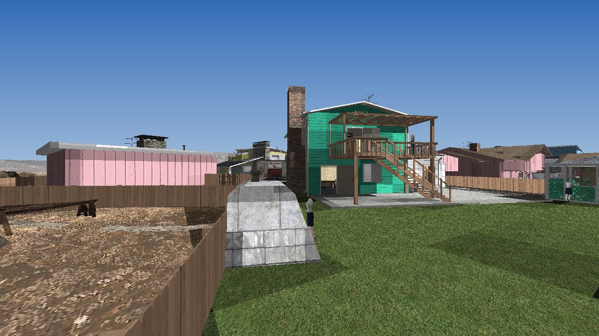
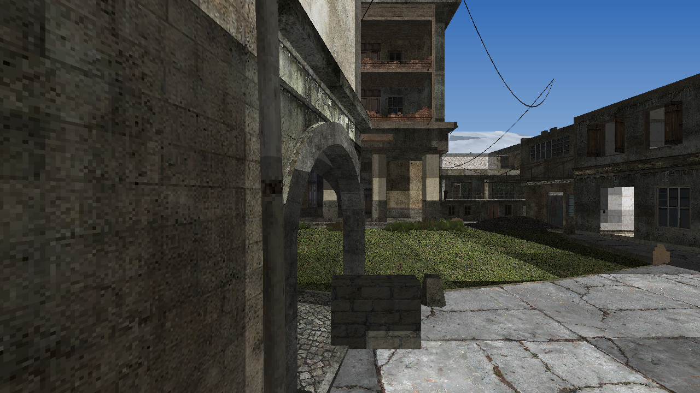
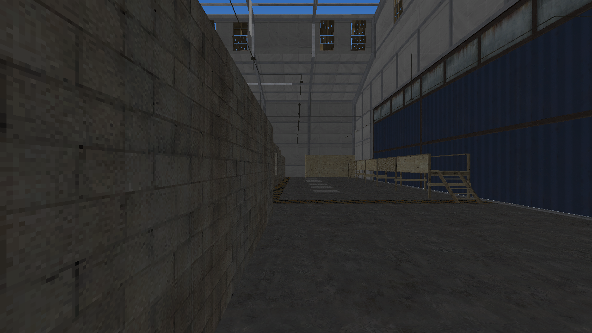
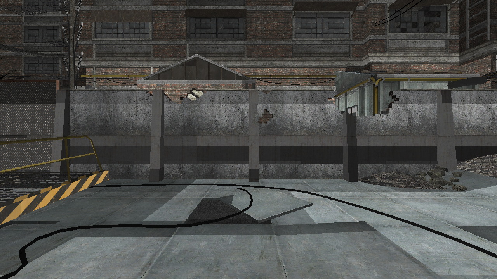

# Project Dragon — Call of Duty Online (1.1.1.13) Native PlayStation 4 Port

<p align="center">
  <strong>A 100% native x86-64 OrbisOS PlayStation 4 port of Call of Duty Online (Offline Client 1.1.1.13).</strong><br>
  <em>Clean-room C++20 engine reconstruction • Zero emulation • Native OrbisOS binaries • Standalone PS4 PKG</em>
</p>

<p align="center">
  
  
  
  
  
  
  
</p>

---

## Overview

**Project Dragon** is an independent, clean-room native PlayStation 4 port of the discontinued Chinese *Call of Duty Online* (targeting the offline retail build `1.1.1.13`).

### Strict Architectural Principles
- **No Wine / Proton**: No Windows runtime or translation layers.
- **No Linux Runtime**: Runs natively on Sony OrbisOS (FreeBSD-derived kernel + POSIX runtime).
- **No Windows Emulation**: The original 32-bit x86 Windows client (`codoMP_client_shipRetail.exe`) is never executed. It is read strictly as a data source to extract the FastFile RSA-2048 key, wrapped IWD AES-192 key, and Wavelet Huffman tables.
- **Native x86-64 Execution**: Directly cross-compiled for the PS4's 8-core AMD Jaguar APU (`-march=btver2`) and packaged into a signed `eboot.bin` FSELF.
- **Native PS4 Hardware Acceleration**: Dual-path rendering backend with dynamic `libScePigletv2VSH.sprx` (OpenGL ES 2.0 on AMD Liverpool GCN GPU) and automatic fallback to `libSceVideoOut` double-buffered 1920×1080 direct-memory scanout.
- **Native DualShock 4 Support**: Implemented via `libScePad` and `libSceUserService`.
- **Zero Asset Redistribution**: The repository contains **no proprietary Activision/Tencent game assets or hardcoded cryptographic keys**. All original maps, models, textures, animations, and sounds are decoded at runtime from the user's own lawfully supplied `1.1.1.13` game files.

---

## Authentic In-Engine Screenshots

Rendered directly by Project Dragon's clean-room C++20 engine from original Call of Duty Online `1.1.1.13` FastFiles (v334) and encrypted `.iwd` image archives (no synthetic replacement geometry or generic textures). Captured on the **PC Debug build** (software rasterizer, 1280×720) with all developer overlays disabled — these are not PS4 captures.

| **Nuketown (`mp_nuked`)** | **Tropical Crash (`mp_crash_tropical`)** |
|:---:|:---:|
| [](docs/screenshots/nuketown.png)<br><sub>*135,069 world vertices • 3,484/3,484 textured surfaces • 2 lightmaps • 1,500 static props*</sub> | [](docs/screenshots/crash_tropical.png)<br><sub>*341,951 world vertices • 12,275/12,275 textured surfaces • 1 lightmap • 1,500 static props*</sub> |

| **Killhouse (`mp_killhouse_sh`)** | **Zombies / Der Riese (`zm_factory_sh`)** |
|:---:|:---:|
| [](docs/screenshots/killhouse.png)<br><sub>*657,673 world vertices • 16,681/16,681 textured surfaces • 27,672 ClipMap brushes*</sub> | [](docs/screenshots/zombies_factory.png)<br><sub>*524,013 world vertices • 14,355/14,355 textured surfaces • decoded `thundergun_zm`*</sub> |

---

## Technical Highlights & Engine Capabilities

### 1. Portable Zero-Dependency Cryptography & Zone Inflation
- **Pure C++20 Crypto**: Clean-room implementations of FIPS 180-4 SHA-256, FIPS 197 AES-128/192/256 (ECB + CTR LE/BE), and Knuth/Montgomery BigInt RSA-2048-OAEP(SHA-256) with PKCS#1 DER parsing. Zero dependency on Windows CryptoAPI or OpenSSL.
- **FastFile v334 Engine**: Supports both signed (`IWff0100` with RSA-2048 key unwrapping) and unsigned (`IWffu100`) FastFiles. Handles the 10-block virtual memory layout and 261 asset loader types.
- **Encrypted `.iwd` Archive Pipeline**: Mounts all 62 encrypted image archives (42,221 images) using AES-192-CTR (big-endian counter increment) and ZIP CRC-32 validation.
- **Texture Decoder**: Native parsing of DXT1, DXT3, DXT5, uncompressed ARGB8/RGB8/A8/L8, and CODOL's proprietary Wavelet-compressed `.iwi` textures via integer CDF 5/3 lifting and Huffman tables.

### 2. World Rendering & Geometry
- **BSP Traversal & GfxWorld**: Decodes packed 44-byte `GfxWorldVertex` streams, 16-bit surface index buffers, embedded lightmap atlases, portal cells, and static model instances (`XModel` LODs).
- **Perspective-Correct Rasterizer**: Multithreaded band-parallel software rasterizer with near-plane sub-triangle clipping, CW culling, 1/w perspective-correct texture & lightmap interpolation, alpha-cutout, sRGB-lifted lightmap gamma, and atmospheric distance haze.
- **PS4 Hardware Backend**: Dynamic loading of `libScePigletv2VSH.sprx` and `libSceShaccVSH.sprx` for full OpenGL ES 2.0 hardware acceleration on the AMD Liverpool GCN GPU with zero launch crashes if external `.sprx` modules are absent.

### 3. Collision, Physics & Offline Gameplay
- **ClipMap Collision**: Swept AABB box-tracing (`CM_BoxTrace`) and ray-tracing (`CM_RayTrace`) against convex `cbrush_t` axial and bevel plane hulls.
- **IW4 Player Movement (`PM_Move`)**: Complete stance machine (walk, sprint, crouch, prone, ADS, jump impulse, gravity, step-climbing, brush wall-sliding, and noclip mode).
- **Weapons & Hit Registration**: Reads real `ASSET_TYPE_WEAPON` headers (e.g. `thundergun_zm`), weapon state timing (idle, fire, ADS, reload, switch), and raycast hit detection.
- **Offline Server & Bot Navigation**: 20 Hz tick server parsing real `MapEnts` entity lumps, `mp_tdm_spawn*` spawn points, and waypoint pathing across `node_pathnode` graphs.
- **GSC VM**: Clean-room cooperative thread VM executing map scripts (`thread`, `wait`, `waittill`, `notify`, `setDvar`).

### 4. Authentic Visual Fidelity & Startup Pipeline
Everything the player sees is loaded at runtime from the user's own client files — no AI-generated logos, redrawn wordmarks or invented menus.

| Element | Original source (user's client) | Status |
|---|---|---|
| PS4 tile `icon0.png` | `codoMP_client_shipRetail.exe` → `RT_GROUP_ICON` ID `1` → `RT_ICON` ID `5` (64×64, 32-bit alpha), extracted locally by `extract_ps4_icon.py` | `IMPLEMENTED` |
| Startup splash | root `splash.bmp` (800×510, shown by `Sys_ShowSplashWindow`) | `IMPLEMENTED` |
| Loading screen | `patch_code_post_gfx_mp.ff` → `ui_mp/load.txt` (`menuDef load`) + `loadscreen_menu.iwi` | `IMPLEMENTED` |
| Fonts | IW `Font_s` assets from `code_post_gfx_mp.ff` + `gamefonts_pc.iwi` / `devfonts_pc.iwi` | `IMPLEMENTED` |
| Login / main-menu logo | Scaleform `codologin.gfx` (`loginView`) and `codo.gfx` (`logoView`) bitmap display lists | `IMPLEMENTED` (bitmaps only) |
| Intro videos | `main/video/PUB_logo.bk2`, `CODO_logo.bk2` (Bink 2 `KB2i`) | `NOT_IMPLEMENTED` — headers parsed, decoder missing, logged as `[UI][UNFINISHED]` |
| Scaleform ActionScript / vector shapes | AS3 `DoABC`, `DefineShape`, CJK `fonts_ingame.gfx`, `codohud.gfx` | `NOT_IMPLEMENTED` — logged as `[UI][UNFINISHED]` |

The engine's own map selector, telemetry HUD, crosshair and bot boxes are **off by default** and only available as explicit developer tools (`--dev-map-menu`, `--dev-hud`, `--dev-crosshair`, `--dev-boxes`, or `L1+R1+TOUCHPAD` on PS4). The PS4 build is currently `COMPILED`; it has not yet been tested on hardware or in an emulator.

---

## Validation & Test Suite

The automated test suite ([test_suite.cpp](tests/test_suite.cpp)) runs against both synthetic unit fixtures and real Call of Duty Online `1.1.1.13` assets:

```text
=== TEST SUMMARY: 33 passed, 0 failed ===
  [PASS] SHA-256 empty string matches FIPS 180-4
  [PASS] SHA-256("abc") matches FIPS 180-4
  [PASS] AES-192 key schedule init
  [PASS] AES-192 ECB block matches FIPS 197 C.2
  [PASS] AES-192-CTR LE encrypts buffer (FastFile)
  [PASS] AES-192-CTR LE decrypts back identically
  [PASS] AES-192-CTR BE encrypts buffer (IWD)
  [PASS] AES-192-CTR BE decrypts back identically
  [PASS] CRC-32("123456789") == 0xCBF43926
  [PASS] CM_RayTrace hits floor cleanly
  [PASS] PlayerController spawns onto floor via CM_BoxTrace
  [PASS] PM_Move stops cleanly against brush wall
  [PASS] MapEnts parser decodes entity blocks
  [PASS] MapEnts extracts mp_tdm_spawn origin
  [PASS] MapEnts extracts node_pathnode waypoint
  [PASS] GSC parser loads script functions
  [PASS] GSC setDvar executes
  [PASS] GSC thread + wait + waittill/notify executes
  [PASS] Mount real CODOL 1.1.1.13 keys & wavelet tables
  [PASS] Discovered real CODOL 1.1.1.13 map FastFiles
  [PASS] Decrypt + inflate + load real FastFile v334: mp_killhouse_sh
  [PASS] Decode real GfxWorld + materials + textures
  [PASS] Real map has valid geometry & decoded IWI textures
  [PASS] Decode real ClipMap collision brushes
  [PASS] Decode real MapEnts entities
  [PASS] Rendered real CODOL map geometry (>100 visible triangles)
  [PASS] AuthenticUiSystem mounts original startup & UI assets
  [PASS] Loaded original root splash.bmp (800x510)
  [PASS] Inspected Bink 2 intro headers (PUB_logo.bk2 & CODO_logo.bk2)
  [PASS] Decoded original IW Font_s (fonts/bigFont) from code_post_gfx_mp.ff
  [PASS] Decoded original IW menuDef_t (ui_mp/load.txt -> load) from patch_code_post_gfx_mp.ff
  [PASS] Scaleform codologin.gfx loginView emits authentic decoded bitmap layers
  [PASS] Scaleform codo.gfx logoView emits 3 authentic logo bitmap layers
```

### Full Map Corpus Validation
The cross-map validator ([dragon_validate](tools/dragon_validate/main.cpp)) verified **64 / 64 (100.0%)** standalone playable maps across the entire installation:
- **58 / 58 Multiplayer Maps**: `mp_killhouse_sh`, `mp_nuked`, `mp_crash_tropical`, `mp_rust`, `mp_highrise`, `mp_terminal_cls`, `mp_cross_fire`, `mp_backlot_sh`, `mp_bloc_sh`, `mp_dome`, etc.
- **6 / 6 Cyborg & Zombies Maps**: `zm_factory_sh`, `zm_theater_sh`, `zm_asylum_sh`, `zm_prototype_sh`, `zm_sumpf_sh`, `zm_zombie_training`.
- **9 Co-op Overlay Missions**: `coop_defense_mp_crash_tropical`, `coop_spec1_mp_killhouse_sh`, etc. (decrypted and verified with automatic base-world resolution).
- Complete per-map audit available in [COMPATIBILITY_REPORT.md](docs/COMPATIBILITY_REPORT.md).

---

## Repository Structure

```text
project-dragon/
├── CMakeLists.txt                         # Unified PS4 OrbisOS + PC Debug build
├── cmake/
│   ├── openorbis-ps4-toolchain.cmake      # OpenOrbis v0.5.4 + LLVM-18 toolchain
│   ├── ps4-link.x                         # Patched linker script (.init_array/.tdata/.data fixes)
│   └── check-oelf.cmake                   # Verifies single RW PT_LOAD segment (prevents CE-41839-5)
├── engine/
│   ├── app/main.cpp                       # PS4 & PC unified entry point, CLI, DualShock 4 UX
│   ├── assets/                            # Runtime key/wavelet extraction, FastFile v334, IWD/IWI cache
│   ├── gfx/                               # Dual-path PS4 renderer (Piglet GLES2 + VideoOut direct-memory)
│   ├── platform/                          # OrbisOS direct memory, pthreads, libScePad, libSceAudioOut, crash log
│   ├── ui/                                # Authentic startup/UI loader (splash.bmp, IW Font_s/menuDef_t, Scaleform GFx bitmaps)
│   └── world/                             # GfxWorld, ClipMap collision, MapEnts, PM_Move, Weapons, GSC VM
├── third_party/
│   └── codol_zone_portable/               # MIT-derived FastFile v334 + IWD/IWI/Wavelet + pure C++20 crypto
├── tools/
│   ├── dragon_pe_inspect/
│   │   ├── inspect_game.py                # Phase 1 PE/FastFile/IWD analyzer
│   │   └── extract_ps4_icon.py            # Extracts authentic PS4 icon0.png from user's codoMP_client_shipRetail.exe
│   └── dragon_validate/main.cpp           # Phase 3 cross-map automated asset validator
├── tests/test_suite.cpp                   # Automated unit & integration tests (33/33 passing)
├── docs/
│   ├── screenshots/                       # In-engine rendered map screenshots
│   ├── TECHNICAL_RESEARCH_REPORT.md       # Empirical Phase 1 analysis & PS4 architecture report
│   ├── DEVELOPMENT_ROADMAP.md             # Strict verification status matrix & development roadmap
│   └── COMPATIBILITY_REPORT.md            # Generated 64-map validation report
├── SETUP.bat / BUILD_PS4.bat / PACKAGE_PS4.bat / PACKAGE_PS4_ALL_IN_ONE.bat / BUILD_PC_DEBUG.bat / VALIDATE_ASSETS.bat
└── scripts/
    ├── setup.sh                           # Download OpenOrbis v0.5.4 & host tool verification
    ├── build_pc_debug.sh                  # Compile PC Debug binaries & run 33 automated tests
    ├── build_ps4.sh                       # Cross-compile native PS4 eboot.bin (FSELF) & verify PT_LOAD
    ├── package_ps4.sh                     # Package clean engine PKG (~6.9 MB, extracts icon0.png locally)
    ├── package_ps4_all_in_one.sh          # Package self-contained All-in-One PKG (~10 GB, personal use)
    └── validate_assets.sh                 # Run full-corpus map validation
```

---

## Building from Source

### Linux / WSL2 (Ubuntu 22.04 / 24.04)

```bash
# 1. Install prerequisites (clang-18, lld-18, cmake, ninja, dotnet 8/10)
sudo apt update && sudo apt install -y clang-18 lld-18 llvm-18 cmake ninja-build dotnet-sdk-8.0 curl python3

# 2. Setup OpenOrbis PS4 Toolchain v0.5.4 & LibOrbisPkg
./scripts/setup.sh

# 3. Build PC Debug targets and execute all 33 automated tests
./scripts/build_pc_debug.sh

# 4. Cross-compile native PS4 executable (build-ps4/eboot.bin)
./scripts/build_ps4.sh

# 5a. Package clean engine PKG (dist/IV0000-DRGN00113_00-PROJECTDRAGON000.pkg, ~6.9 MB)
#     Extracts the authentic PS4 tile icon locally from your codoMP_client_shipRetail.exe:
./scripts/package_ps4.sh "/path/to/Call of Duty Online 1.1.1.13"

# 5b. (Optional, personal console use) Package self-contained All-in-One PKG (~10 GB)
#     bundling your local CODOL 1.1.1.13 files directly into /app0/codol inside the PKG:
./scripts/package_ps4_all_in_one.sh "/path/to/Call of Duty Online 1.1.1.13"

# 6. Run full-corpus automated asset validation against your game installation
./scripts/validate_assets.sh "/path/to/Call of Duty Online 1.1.1.13" --all
```

### Windows (CMD / PowerShell)
Run the automated batch scripts in sequence:
- `SETUP.bat`
- `BUILD_PC_DEBUG.bat`
- `BUILD_PS4.bat`
- `PACKAGE_PS4.bat "<path-to-codol>"` *(or `PACKAGE_PS4_ALL_IN_ONE.bat "<path-to-codol>"`)*
- `VALIDATE_ASSETS.bat "<path-to-codol>"`

---

## Deploying to PlayStation 4 (Jailbroken FW 5.05–11.00+)

### Option A — Single All-in-One PKG (Plug-and-Play)
1. Build using `./scripts/package_ps4_all_in_one.sh "<your-codol-dir>"` to generate `dist/all-in-one/IV0000-DRGN00113_00-PROJECTDRAGON000.pkg`.
2. Install the `.pkg` on your PS4 via GoldHEN Package Installer.
3. Launch **Call of Duty Online** (`DRGN00113`) directly from the home screen. The engine automatically mounts its internal `/app0/codol` asset tree with zero file copying needed.

### Option B — Clean Engine PKG + External Game Folder
1. Build the lightweight **`dist/IV0000-DRGN00113_00-PROJECTDRAGON000.pkg`** (~6.9 MB) locally with `./scripts/package_ps4.sh "<your-codol-dir>"` (which extracts the authentic `icon0.png` tile from your `codoMP_client_shipRetail.exe`) and install via GoldHEN Package Installer.
2. Copy your lawfully obtained **Call of Duty Online `1.1.1.13`** game folder onto the PS4 internal HDD at **`/data/codol/`** (or external USB at **`/usb0/codol/`**):
   - `codoMP_client_shipRetail.exe` *(read strictly at runtime for key/wavelet tables; never executed)*
   - `splash.bmp`, `logo.bmp`, `localization.txt` *(original root startup splash and metadata)*
   - `client_shipRetail/chinese/*.ff` and `client_shipRetail/patch/*.ff`
   - `main/*.iwd` *(and optionally `main/video/*.bk2`)*
3. *(Optional for AMD GCN Piglet hardware acceleration)*: If you dump `libScePigletv2VSH.sprx` and `libSceShaccVSH.sprx` from your console, place them in `/data/project_dragon/modules/`. If absent, the engine falls back seamlessly to native 1920×1080 `libSceVideoOut` direct-memory scanout.
4. Launch **Call of Duty Online** (`DRGN00113`) from the PS4 home screen.

---

## DualShock 4 Controls

| Button | Action |
|---|---|
| **Left Stick** | Walk / Strafe (Click **L3**: Sprint) |
| **Right Stick** | Look / Aim |
| **Cross (✕)** | Jump / Advance Startup Screen / Confirm in Dev Map Selector |
| **Circle (○)** | Crouch / Prone (hold) / Close Dev Map Selector |
| **R2** | Fire Weapon |
| **L2** | Aim Down Sights (ADS) |
| **Square (□)** | Reload |
| **D-Pad Up** | Toggle Noclip Mode (in-game) |
| **D-Pad Down / Right** | Toggle Lightmaps / Wireframe (in-game) |
| **OPTIONS (hold 3s)** | Exit application cleanly on PS4 |
| **L1 + R1 + TOUCHPAD** | Open explicit `[DEV TOOL]` Map Selector (all 64+ playable MP & Zombies maps) |
| **TOUCHPAD** | Toggle explicit `[DEV TOOL]` Debug Console (`/data/project_dragon/crash.log`) |

---

## Legal & Clean-Room Statement

- Project Dragon is a clean-room independent reverse-engineering and preservation initiative.
- Engine code is licensed under the **MIT License**.
- `third_party/codol_zone_portable/` is adapted from the MIT-licensed format research in `nucleur16/sh1xo-radiant`, rewritten for pure C++20 and POSIX environments.
- Linker fixes (`cmake/ps4-link.x`) and OELF validation (`cmake/check-oelf.cmake`) incorporate MIT-licensed work from `iHaiDeeZ/ps4-kit`.
- **No copyrighted Call of Duty Online game assets, maps, models, textures, audio, executable binaries, or hardcoded decryption keys are hosted or redistributed in this repository.** Users must provide their own lawfully obtained copy of Call of Duty Online `1.1.1.13`.
